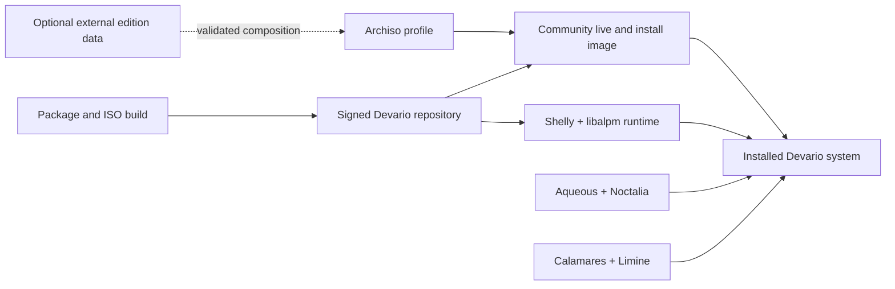

# Devario OS Architecture

Status: implemented core architecture

Devario OS is the independently usable operating-system core shared by the
Community edition and any separately maintained editions. It contains the
Archiso profile, Aqueous desktop, Calamares installer, Shelly package manager,
package recipes, release validation, and hardware enablement required to build
and install Devario.

The core does not require a fleet-management service, an organization account,
or an external edition overlay. A default checkout always validates and builds
the Community edition.

## Components

| Component | Responsibility |
| --- | --- |
| Archiso profile | Defines the live image, installer environment, boot media, and installed-system defaults. |
| Aqueous and Noctalia | Provide the Wayland compositor, shell, greeter, and desktop session. |
| Calamares | Copies the tested live root and configures the target installation. |
| Limine | Boots installed systems through UEFI or legacy BIOS. |
| Shelly | Synchronizes repositories and performs package installation, removal, upgrade, signature verification, and inventory. |
| `devario-alpm-runtime` | Supplies `libalpm` and required runtime data without the Pacman command-line programs. |
| Devario package repository | Delivers signed core packages and repository metadata. |

## Package-management boundary

The live system, installed system, package build, and ISO population paths use
Shelly. The image does not include the `pacman` or `pacman-key` executables.
`makepkg` remains the archive builder and `repo-add` remains the repository
metadata writer because Shelly consumes those formats rather than replacing
them.

The build validates this boundary, checks requested versus installed package
inventories, and rejects dormant process calls to Pacman-family executables.
Shelly reads `/etc/shelly.conf`, stores its local and synchronization databases
under `/var/lib/shelly`, caches packages under `/var/cache/shelly/pkg`, and
uses `/etc/shelly.d` for its mutable keyring and local hooks. The Arch
mirrorlist and distributed keyring sources retain their upstream paths because
they are immutable compatibility inputs rather than Shelly runtime state.

## Image and installation flow

1. Package recipes build the pinned Devario-owned packages.
2. The repository database and packages are signed for release builds.
3. ISO construction verifies package presence and signatures before asking
   Shelly to populate the staged Archiso root.
4. The live image boots Aqueous and exposes Calamares.
5. Calamares copies the prepared live root, configures the selected disk, and
   installs Limine for the target firmware paths.
6. The installed system initializes its own Arch and Devario public keyrings
   before normal package operations.

## Edition composition

The Community definition lives in `editions/community`. Build and validation
commands may instead receive an external edition directory. Edition data can
change image metadata, add or remove permitted package names, and merge
configuration-only filesystem overlays into a temporary copy of the base
profile.

Composition is deliberately restrictive:

- an external edition locks to an exact Devario OS commit;
- configuration is parsed as data and cannot execute shell code;
- removal of required core packages is rejected;
- replacement of a core overlay file requires an exact allowlist entry;
- special files, escaping symlinks, executable overlay files, and unused
  replacement entries are rejected; and
- input repositories are never modified during composition.

Edition-specific executable code must arrive as a package rather than as a raw
filesystem overlay. This preserves file ownership, mode, licensing, upgrade,
and signature information.

## Trust boundary

Community systems trust only the Devario core repository key distributed by
`devario-keyring`. The key currently checked into this development tree is a
public development key and is not a production trust root. Release images must
use signed HTTPS repositories and a separately controlled production key.

External editions may introduce an additional repository and trust root in
their own package set. They must not replace, re-sign, or silently duplicate
core artifacts. A Community build must not contain an external edition's key,
repository URL, credentials, policy, or packages.

## Current scope

Implemented here:

- bootable Devario image and installed Aqueous desktop;
- Calamares installation and Limine boot configuration;
- Shelly-only runtime and build boundary;
- local development signing and release-mode signature enforcement;
- NVIDIA open-driver detection and startup ordering; and
- validated Community/external-edition composition.

Fleet policy, device enrollment, centralized reporting, Active Directory
automation, and commercial service operation are outside this repository.
